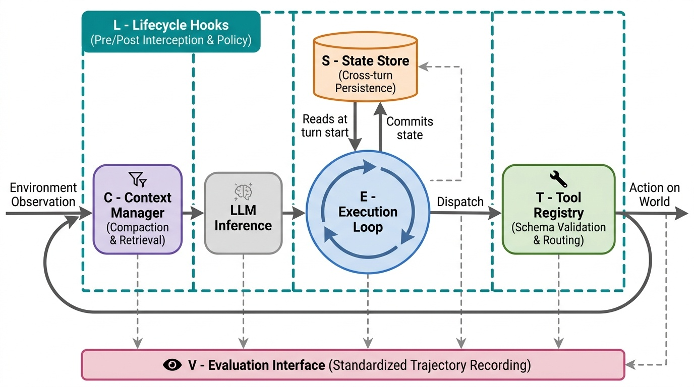
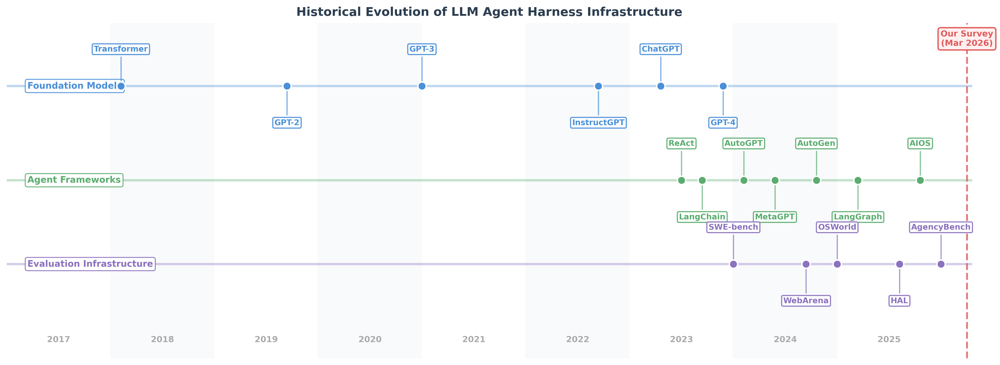

<div align="center">

[English](README.md) | [中文](README_zh.md)

# Agent Harness for Large Language Model Agents: A Survey

### Official paper repository and living evidence index

[](https://github.com/Gloriaameng/Awesome-Agent-Harness)
[](#5-research-library)
[](license)

</div>

> **Agent capability emerges from a model–harness–environment configuration.** The harness decides how the model observes, acts, uses tools, manages context and state, crosses permission boundaries, recovers from failure, and leaves evidence for evaluation.

This is the official repository for **_Agent Harness for Large Language Model Agents: A Survey_**. The paper is the center of the project: it defines the object of study, introduces the ETCSLV analytical framework, reconstructs the field's historical lineages, compares representative systems, and sets an evaluation and research agenda. The resource index below keeps the survey's evidence base current between paper releases.

📄 **[Paper v4](./Agent_Harness_for_LLM_Agents__A_Survey__v4.pdf)** · 🌐 **[Archived preprint v3](https://www.preprints.org/manuscript/202604.0428/v3)** · 🗂️ **Resource Index 2026.10** (evidence through 2026-10-13) · **Paper v5 is in revision**

[Survey contributions](#what-this-survey-contributes) · [Framework](#1-conceptual-framework) · [Systems](#3-system-landscape) · [Benchmarks](#4-evaluation-landscape) · [Research library](#5-research-library)

---

## Read and Cite the Survey

**Qianyu Meng et al. (2026), _Agent Harness for Large Language Model Agents: A Survey_.** The repository PDF is **v4**; the current DOI resolves to the archived **v3** preprint. Paper v5 remains unpublished while its manuscript, figures, and references are being revised.

- **Read:** [Paper v4 PDF](./Agent_Harness_for_LLM_Agents__A_Survey__v4.pdf)
- **Preprint:** [Archived v3 record](https://www.preprints.org/manuscript/202604.0428/v3)
- **Cite:** [DOI 10.20944/preprints202604.0428.v3](https://doi.org/10.20944/preprints202604.0428.v3)

```bibtex
@article{meng2026agentharness,
  title     = {Agent Harness for Large Language Model Agents: A Survey},
  author    = {Meng, Qianyu and Wang, Yanan and Chen, Liyi and Wu, Wei and
               Li, Yihang and Jiang, Wenyuan and Wang, Qimeng and
               Lu, Chengqiang and Gao, Yan and Wu, Yi and Hu, Yao},
  year      = {2026},
  doi       = {10.20944/preprints202604.0428.v3},
  url       = {https://www.preprints.org/manuscript/202604.0428/v3},
  publisher = {Preprints}
}
```

---

## What This Survey Contributes

Most agent reports foreground the model and task score while leaving the runtime configuration implicit. The survey makes that missing layer explicit and connects conceptual analysis to systems, benchmarks, and engineering evidence.

1. **A joint unit of analysis.** Agent behavior is studied at the **model–harness–environment** level, so results can be attributed to the configuration that produced them.
2. **A shared architectural lens.** **ETCSLV** organizes recurring harness functions into execution, tools, context, state, lifecycle, and evaluation.
3. **A historical account.** The survey connects software test harnesses, reinforcement-learning environments, early LLM-agent frameworks, and today's persistent agent runtimes.
4. **A comparable system landscape.** Thirty-four systems are assessed with the same evidence-coded component matrix, including coding, application-runtime, workplace, personal-agent, OS, and meta-harness routes. The set remains open as public evidence improves; Claude Code, Codex, DeepSeek Harness, and OpenClaw receive equal-depth treatment as anchor cases.
5. **An evaluation map.** Harness-effect benchmarks, lifecycle and security tests, long-horizon recovery, protocol benchmarks, evaluation infrastructure, and task environments are separated by what they actually vary.
6. **A research agenda for evolving runtimes.** The survey connects context, memory, tools, security, observability, and cost to harness evolution and bounded runtime self-improvement.

### What the landscape reveals

- **The harness is an experimental variable.** Changing tools, context policy, state, permissions, or loop logic can change observed behavior even when the model is fixed.
- **Architectural coverage and product maturity are different questions.** ETCSLV records what a system exposes; reliability, adoption, and quality require their own evidence.
- **Long-horizon agents turn traces and lifecycle events into research objects.** Final-task success alone cannot explain recovery, policy decisions, accumulated state, or regressions.
- **Runtime self-improvement needs an outer evaluation loop.** Persistent changes should be isolated, tested on held-out tasks, versioned, gated for safety and cost, and reversible.

## Survey and Repository Map

The README follows the survey's argument rather than presenting a detached software catalog. Read the numbered sections in order for the conceptual account; use each directory as the maintained evidence layer behind that part of the paper.

| Survey question | Repository section | What you will find |
|---|---|---|
| What is the harness layer? | [1. Conceptual Framework](#1-conceptual-framework) | Model–harness–environment boundary and ETCSLV |
| Where did this architecture come from? | [2. Historical Evolution](#2-historical-evolution) | Test harness, RL environment, LLM-agent, and runtime lineages |
| Which systems implement it? | [3. System Landscape](#3-system-landscape) | Four anchor cases, an open 34-system evidence matrix, and a categorized directory |
| How should it be evaluated? | [4. Evaluation Landscape](#4-evaluation-landscape) | 30 direct harness benchmarks, evaluation infrastructure, and task environments |
| What evidence supports each engineering problem? | [5. Research Library](#5-research-library) | 168 papers, specifications, architecture notes, and reports organized by engineering problem |
| How were entries selected and how does this relate to the paper? | [About the Survey](#about-the-survey) | Evidence rules, versions, citation, and contribution guide |

---

## 1. Conceptual Framework

We analyze a harness as **H = (E, T, C, S, L, V)**: six governance functions that repeatedly appear across public systems. The lens compares architectural coverage; product quality and production readiness require separate evidence.

<p align="center">
  
</p>

| Component | Symbol | What to look for |
|---|:---:|---|
| Execution Loop | **E** | Turn and step control, termination, retry, recovery, delegation |
| Tool Registry | **T** | Typed tools, routing, validation, authorization, result handling |
| Context Manager | **C** | Prompt assembly, retrieval, compaction, salience, provenance |
| State Store | **S** | Cross-turn and cross-session persistence, checkpoints, recovery |
| Lifecycle Hooks | **L** | Authentication, approval, policy, instrumentation, interception |
| Evaluation Interface | **V** | Trajectories, intermediate state, outcomes, experiments, audit |

---

## 2. Historical Evolution

<p align="center">
  
</p>

| Year | Milestone | Why it matters to harnesses |
|---|---|---|
| 1997–2005 | JUnit, TestNG, xUnit family | Standardized setup, execution, observation, assertion, and teardown |
| 2016 | OpenAI Gym | Made step/reset a canonical interface between agents and environments |
| 2022 | ChatGPT and LangChain | Brought tool use and composable LLM applications into a common runtime pattern |
| 2023 | ReAct, Toolformer, MemGPT, Reflexion, Voyager, AutoGPT | Established reasoning–acting, memory, reflection, and skill accumulation patterns |
| 2023 | CAMEL, ChatDev, Generative Agents | Expanded orchestration to roles, teams, and social simulation |
| 2023 | AgentBench, SWE-bench | Made environment design and agent evaluation central infrastructure |
| 2024 | MetaGPT, WebArena, ToolLLM, SWE-agent, OSWorld | Connected agents to realistic tools, repositories, browsers, and desktops |
| 2024 | CodeAct, LATS, Tree of Thoughts | Explored executable actions and search-based control policies |
| 2024 | Model Context Protocol | Standardized a growing part of the tool-to-harness boundary |
| 2025 | HAL, AIOS, LangGraph, A2A | Advanced evaluation infrastructure, agent OS design, durable graphs, and agent interoperability |
| 2025 | MemoryOS, AgentBound† | Developed memory abstractions and runtime enforcement |
| 2026 | Antigravity, workplace and personal agents, Harness-Bench, HarnessX, LongHorizon-Harness, HarnessAudit-Bench, SCLATE | Expanded harnesses across coding, workplace, and personal agents while making harness choice, evolution, long-horizon operation, lifecycle risk, and auditability direct objects of study |

---

## 3. System Landscape

The system landscape moves from depth to breadth: four anchor cases expose the runtime in detail, the evidence matrix applies one comparison scheme, and the directory preserves the wider ecosystem of systems, substrates, modules, and evaluation infrastructure. The comparison set is evidence-driven and open-ended; 34 is the current result of the inclusion rule, not a target or a claim of completeness. Product form is not an exclusion rule: workplace and personal agents belong when their runtime architecture is documented well enough to assess.

### Four Anchor Systems

These four systems are the survey's anchor cases. They receive the same analytical weight because each exposes a distinct answer to the same runtime problem: how to turn model calls into governed, persistent, tool-using work.

- **[Claude Code](https://github.com/anthropics/claude-code)** — A vertically integrated coding harness that joins repository inspection, edits, commands, web and MCP tools, subagents, skills, hooks, permissions, checkpoints, and session continuation. Its CLI and [Agent SDK](https://github.com/anthropics/claude-agent-sdk-python) make the execution and policy layers visible across interactive and programmable use.
- **[Codex](https://github.com/openai/codex)** — An open-source coding harness spanning terminal, IDE, app, and cloud workflows. Its runtime combines repository tools, sandboxing, approvals, MCP, skills, subagents, compaction, resumable threads, and structured events. The shared runtime makes long-horizon work inspectable across surfaces, while OpenAI's [harness engineering](https://openai.com/index/harness-engineering/) account shows how those controls shape sustained software work.
- **[DeepSeek Harness](https://github.com/deepseek-ai/deepseek-harness)** — A plugin-native runtime in which model adapters, loops, tools, context projection, storage, telemetry, and interfaces are composed through profiles, bundles, and ordered patches. These boundaries let teams replace and audit the loop, context policy, tool behavior, and observability separately. The [architecture](https://github.com/deepseek-ai/deepseek-harness/blob/master/docs/architecture.md), [tool subsystem](https://github.com/deepseek-ai/deepseek-harness/blob/master/packages/core/tools/README.md), and [compaction design](https://github.com/deepseek-ai/deepseek-harness/blob/master/docs/subsystems/compaction.md) also provide a concrete base for bounded, evaluated, reversible harness-level improvement.
- **[OpenClaw](https://github.com/openclaw/openclaw)** — An always-on personal-agent harness organized around channels, sessions, tools, skills, memory, scheduled work, gateway routing, and sandboxed execution. It makes deployment continuity central: identity, credentials, background jobs, workspace state, and operational policy persist beyond a single chat turn. That operating model makes it a key case for studying durable personal agents rather than one-shot assistants.

### Evidence-Coded Comparison Matrix

Ratings describe documented component coverage at the evidence cutoff. Quality, production maturity, and adoption are reported separately; popularity and stars serve only as adoption signals.

**Legend:** ● **Full** — built in and documented · ◐ **Partial** — limited, optional, or supplied by an official extension · ○ **Absent** — first-party material explicitly excludes it · ? **Unverified** — public evidence is insufficient.

| Category | System | E | T | C | S | L | V |
|---|---|:---:|:---:|:---:|:---:|:---:|:---:|
| Anchor coding harnesses | **Claude Code** | ● | ● | ● | ◐ | ● | ◐ |
| Anchor coding harnesses | **Codex** | ● | ● | ● | ● | ● | ◐ |
| Anchor coding harnesses | **DeepSeek Harness** | ● | ● | ● | ● | ● | ◐ |
| Anchor coding harnesses | **OpenClaw** | ● | ● | ● | ● | ● | ◐ |
| Coding harnesses | **Antigravity CLI** | ● | ● | ● | ● | ● | ◐ |
| Coding harnesses | **OpenCode** | ● | ● | ● | ● | ● | ◐ |
| Coding harnesses | **Goose** | ● | ● | ◐ | ◐ | ● | ◐ |
| Coding harnesses | **Grok Build** | ● | ● | ● | ● | ● | ◐ |
| Coding harnesses | **Cline** | ● | ● | ◐ | ● | ● | ◐ |
| Coding harnesses | **OpenHands** | ● | ● | ● | ● | ● | ◐ |
| Coding harnesses | **Deep Agents** | ● | ● | ● | ● | ● | ● |
| Coding harnesses | **Prime Agent** | ● | ● | ● | ● | ◐ | ◐ |
| Coding harnesses | **GitHub Copilot in VS Code** | ● | ● | ● | ● | ● | ● |
| Coding harnesses | **MiMo-Code** | ● | ● | ● | ● | ● | ● |
| General runtimes | **OpenAI Agents SDK** | ● | ● | ● | ● | ● | ● |
| General runtimes | **Google ADK** | ● | ● | ● | ● | ● | ● |
| General runtimes | **Microsoft Agent Framework** | ● | ● | ● | ● | ● | ● |
| General runtimes | **LangGraph** | ● | ◐ | ◐ | ● | ◐ | ◐ |
| General runtimes | **Mastra** | ● | ● | ● | ● | ● | ● |
| Persistent, meta, and operational harnesses | **DeerFlow** | ● | ● | ● | ● | ● | ◐ |
| Persistent, meta, and operational harnesses | **AOHP** | ● | ● | ● | ● | ● | ◐ |
| Persistent, meta, and operational harnesses | **Omnigent** | ● | ● | ◐ | ● | ● | ◐ |
| Persistent, meta, and operational harnesses | **TrueForge** | ● | ● | ● | ● | ● | ● |
| Persistent, meta, and operational harnesses | **LongHorizon-Harness** | ● | ◐ | ● | ● | ● | ● |
| Persistent, meta, and operational harnesses | **Hermes Agent** | ● | ● | ● | ● | ● | ● |
| Persistent, meta, and operational harnesses | **SandBase** | ● | ● | ◐ | ● | ● | ● |
| Workplace and personal-agent harnesses | **WorkBuddy** | ● | ● | ● | ● | ● | ● |
| Workplace and personal-agent harnesses | **Muse** | ● | ● | ● | ● | ● | ◐ |
| Workplace and personal-agent harnesses | **Amazon Quick** | ● | ● | ● | ● | ● | ● |
| Workplace and personal-agent harnesses | **OpenAI Workspace Agents** | ● | ● | ● | ● | ● | ◐ |
| Workplace and personal-agent harnesses | **QwenWork** | ● | ● | ● | ● | ● | ? |
| Workplace and personal-agent harnesses | **OpenAI dots** | ● | ● | ● | ● | ● | ◐ |
| Workplace and personal-agent harnesses | **Grok Bot** | ● | ● | ● | ● | ● | ? |
| Workplace and personal-agent harnesses | **OpenJarvis** | ● | ● | ● | ● | ● | ● |

### System Directory

The matrix includes every current system for which first-party material is sufficient to rate the six components at a useful level. It is neither a top-34 list nor a maturity ranking. Systems with a different analysis unit, incomplete evidence, or a narrower capability remain visible in the categorized directory below.

#### Compared coding harnesses

The four featured systems above are joined by ten coding harnesses in the comparison set.

- **[Antigravity CLI](https://antigravity.google/blog/introducing-google-antigravity-2?hl=en)** — Google's current coding harness, with dynamic subagents, asynchronous tasks, skills, hooks, project permissions, scheduled work, and a CLI that carries these controls into terminal workflows. It succeeds Gemini CLI for consumer use; Google documents the [migration](https://github.com/google-gemini/gemini-cli/discussions/27274) separately.
- **[OpenCode](https://github.com/anomalyco/opencode)** — An open-source coding agent with terminal and client/server surfaces, multi-provider model support, tool execution, sessions, and extensibility.
- **[Goose](https://github.com/aaif-goose/goose)** — A local, extensible coding agent whose tools and integrations are exposed through extensions and MCP-compatible interfaces.
- **[Grok Build](https://github.com/xai-org/grok-build)** — xAI's open coding-agent harness for repository work, tool use, context handling, and iterative verification.
- **[Cline](https://github.com/cline/cline)** — An IDE coding agent with plan/act workflows, checkpoints, browser and terminal tools, MCP integrations, and explicit approval points.
- **[OpenHands](https://github.com/OpenHands/OpenHands)** — A platform for software-development agents with isolated runtimes, event streams, tool execution, browsing, delegation, and evaluation integrations.
- **[Deep Agents](https://github.com/langchain-ai/deepagents)** — A batteries-included agent harness that combines planning, filesystems, subagents, context management, memory, and LangGraph execution.
- **[Prime Agent](https://github.com/PrimeIntellect-ai/prime-agent)** — A coding-agent system centered on long-running repository tasks, execution environments, trajectory capture, and training/evaluation workflows.
- **[GitHub Copilot in VS Code](https://code.visualstudio.com/blogs/2026/05/15/agent-harnesses-github-copilot-vscode/)** — An editor-native production harness with model-specific context and tool adaptation, explicit loop control, portable sessions, permission hooks, and a documented evaluation pipeline.
- **[MiMo-Code](https://github.com/XiaomiMiMo/MiMo-Code)** — Xiaomi's terminal coding harness with persistent project memory, checkpoints, context reconstruction, subagents, skills, MCP, permission rules, and judge-driven research and experiment loops.

#### General agent runtimes

- **[OpenAI Agents SDK](https://github.com/openai/openai-agents-python)** — A runtime for tools, handoffs, guardrails, sessions, tracing, and multi-agent workflows. OpenAI's [2026 architecture update](https://openai.com/index/the-next-evolution-of-the-agents-sdk/) extends the same runtime toward longer-lived, stateful work.
- **[Google ADK](https://github.com/google/adk-python)** — An agent development kit with workflow agents, tools, sessions, callbacks, evaluation, and deployment integrations.
- **[Microsoft Agent Framework](https://github.com/microsoft/agent-framework)** — Microsoft's runtime for agents, workflows, middleware, memory, tools, observability, and evaluation; its [Build 2026 update](https://devblogs.microsoft.com/agent-framework/microsoft-agent-framework-at-build-2026-announce/) documents the platform's current direction.
- **[LangGraph](https://github.com/langchain-ai/langgraph)** — A stateful graph runtime for durable execution, checkpoints, interrupts, streaming, and human-in-the-loop agent workflows.
- **[Mastra](https://github.com/mastra-ai/mastra)** — A TypeScript-native application runtime with autonomous agents, graph workflows, tools and MCP, stored suspend/resume state, memory, observability, and built-in evaluation.

#### Persistent, meta, OS, and operational harnesses

- **[DeerFlow](https://github.com/bytedance/deer-flow)** — A modular agent harness for research and coding workflows with subagents, skills, memory, sandbox execution, and long-running tasks.
- **[AOHP](https://github.com/aohp-os/aohp)** — An OS-level harness for personalized interaction, local resources, efficiency, and security boundaries.
- **[Omnigent](https://github.com/omnigent-ai/omnigent)** — A general agent platform joining tool use, state, memory, policy, and multi-surface execution.
- **[TrueForge](https://github.com/truefoundry/trueforge)** — A self-hosted, vendor-neutral runtime and control plane spanning model calls, MCP and skills, sandboxing, approvals, deferred tools, context compaction, persistent sessions, identity, inspection, and reproducible experiments. [Engineering note](https://www.truefoundry.com/blog/engineering/trueforge-open-source-agent-harness/)
- **[LongHorizon-Harness](https://github.com/AMAP-ML/LongHorizon-Harness)** — A meta-harness that wraps existing coding agents in plan–act–verify, durable state, role isolation, audit, checkpoint, and recovery loops. [Paper](https://arxiv.org/abs/2608.01964)
- **[Hermes Agent](https://github.com/nousresearch/hermes-agent)** — A persistent personal-agent runtime with memory, agent-created skills, multi-channel gateways, several sandbox backends, subagents, approvals, checkpoints, context compression, trajectories, and batch evaluation. [Docs](https://hermes-agent.nousresearch.com/docs/)
- **[SandBase](https://github.com/sandbaseai/sandbase-harness)** — A local-first operations and security control plane with resumable sessions, audit and replay, MCP toolsets, credential and approval policy, several sandbox backends, typed SDKs, and conformance tests.

#### Workplace and personal-agent harnesses

- **[WorkBuddy](https://www.workbuddy.ai/)** — Tencent Cloud's office harness plans and executes cross-tool work across messaging, documents, mail, meetings, and knowledge bases. Its [open platform](https://open.workbuddy.cn/en/docs/buddy-app) and [managed-agent runtime](https://cloud.tencent.com/document/product/1831/138968) expose skills, MCP/OAuth/A2A, multi-agent orchestration, context compression, memory, isolated execution, recovery, traces, evaluation, and lifecycle governance.
- **[Muse](https://muse.ai/)** — Meta's personal-agent harness runs each agent in a persistent isolated VM with a browser, filesystem, terminal, memory, connected apps, self-built tools, scheduled and event-driven work, action approvals, credential isolation, and a complete activity trail. [Design account](https://introducing.muse.ai/) · [Launch and security architecture](https://about.fb.com/news/2026/09/introducing-muse-personal-ai-agent)
- **[Amazon Quick](https://aws.amazon.com/about-aws/whats-new/2026/06/amazon-quick/)** — A workplace harness combining autonomous background agents, reusable flows, enterprise data spaces, granular autonomy, identity propagation, approvals, monitoring, and [test runs with logs and watch variables](https://docs.aws.amazon.com/quick/latest/userguide/automate-custom-agents.html).
- **[OpenAI Workspace Agents](https://openai.com/index/introducing-workspace-agents-in-chatgpt/)** — Codex-powered organizational agents with shared skills, files, apps and MCP, cloud execution, schedules and Slack triggers, approval handoffs, role-based publishing, version history, analytics, and Compliance API visibility.
- **[QwenWork](https://www.alibabacloud.com/help/en/qwenwork/qwenwork-intro)** — A personal and organizational work platform with explicit Agent sessions, plans and intermediate results, files, skills, connectors, scheduled tasks, computer use, workspace isolation, and sensitive-action confirmation; a public general evaluator remains unverified.
- **[OpenAI dots](https://openai.com/index/introducing-dots/)** — Always-on personal agents with a dedicated cloud computer and browser, plugins, persistent memory and notes, scheduled and proactive work, local and Codex-cloud actions, custom rules, auto-review, and approvals.
- **[Grok Bot](https://x.ai/news/introducing-grok-bot)** — A persistent cloud-computer agent with browser, terminal, apps, parallel bots, bot-to-bot coordination, chief-of-staff hierarchies, and demonstration-to-routine learning; [enterprise controls](https://x.ai/news/grok-bot-for-enterprise) add isolation, access, network, and audit governance.
- **[OpenJarvis](https://github.com/open-jarvis/OpenJarvis)** — A local-first, on-device personal-agent stack with typed runtime primitives, multiple agent loops, tools and MCP, sandboxing, several memory backends, scheduled operatives, full traces, trace-driven routing, and joint accuracy, latency, energy, and cost evaluation. [Paper](https://arxiv.org/abs/2605.17172)

#### Workplace and personal-agent watchlist

These systems remain in the index while their public architecture, maturity, or independent analysis unit is still emerging.

- **[Microsoft Copilot Autopilot](https://blogs.microsoft.com/blog/2026/09/25/introducing-the-new-copilot-with-home-code-and-autopilot/)** — A preview workplace agent with its own identity, memory, computer, workspace, and enterprise governance; public tool and evaluation documentation is still limited.
- **[Google Workspace Studio](https://workspace.google.com/blog/product-announcements/introducing-google-workspace-studio-agents-for-everyday-work)** — An agentic workplace flow builder with a 2026 [least-privilege, HITL, DLP, drift-detection, and audit update](https://workspace.google.com/blog/identity-and-security/defend-against-agentic-risks-with-multi-layered-protections-in-google-workspace-studio).
- **[Claude Tag](https://www.anthropic.com/news/introducing-claude-tag)** — A shared, persistent workplace interaction built from Claude Code and Cowork concepts; treated as a product surface of that lineage until a distinct runtime boundary is documented.
- **[Claude Managed Agents](https://www.anthropic.com/news/finance-agents)** — Long-running enterprise sessions with per-tool permissions, credential vaulting, and audit logs; retained as a workplace deployment case related to the Claude runtime lineage.
- **[nanoMuse](https://github.com/nano-muse/nanoMuse)** — A new open personal agent spanning phones and desktops with scheduled goals, editable memory, and risk gates; parts of the system build on DeepSeek Harness and OpenMinis. [Paper](https://arxiv.org/abs/2610.08699)
- **[Qwen Book](https://www.alibabacloud.com/blog/603599)** — An early “OS as harness” workplace device combining model, operating system, apps, cloud, context, memory, execution, and governance; detailed component evidence is still limited.

#### Extended catalog

- **[Aider](https://github.com/Aider-AI/aider)** — Terminal pair programming with repository maps, edit formats, git integration, and broad model support.
- **[mini-SWE-agent](https://github.com/SWE-agent/mini-swe-agent)** — A deliberately minimal software-engineering agent with a short linear loop, multiple sandbox backends, trajectory inspection, and broad benchmark use; the SWE-agent maintainers recommend it for new work.
- **[SWE-agent](https://github.com/SWE-agent/SWE-agent)** — An agent-computer interface designed for solving software-engineering issues in repository environments.
- **[AutoGen](https://github.com/microsoft/autogen)** — An event-driven framework for conversational and multi-agent applications.
- **[MetaGPT](https://github.com/geekan/MetaGPT)** — A multi-agent software workflow organized around roles, standard operating procedures, and shared artifacts.
- **[CAMEL](https://github.com/camel-ai/camel)** — A multi-agent framework for role-playing, tool use, memory, and agent societies.
- **[ChatDev](https://github.com/OpenBMB/ChatDev)** — A virtual software company that coordinates specialized agents through a staged development process.
- **[AIOS](https://github.com/agiresearch/AIOS)** — A research operating-system architecture that separates an agent kernel from the Cerebrum SDK and mediates models, tools, memory, storage, and access control; it remains historically important, while its analysis unit and incomplete public lifecycle/evaluation evidence differ from the full runtime matrix.
- **[Raven](https://github.com/EverMind-AI/Raven)** — A composable “harness of harnesses” for assembling and coordinating agent capabilities.
- **[Open SWE](https://github.com/langchain-ai/open-swe)** — An open-source asynchronous coding-agent reference built for delegated repository work.
- **[QM](https://github.com/yc-software/qm)** — An open coding-agent project exploring autonomous repository work and tool-driven development.
- **[Eve](https://github.com/vercel/eve)** — Vercel's open agent project for iterative software work and execution-driven feedback.
- **[Shepherd](https://github.com/shepherd-agents/shepherd)** — An agent orchestration project for coordinating development tasks and specialized workers.
- **[YYLO](https://github.com/yylo-dev/yylo)** — A CLI for orchestrating coding agents with plugins, evidence capture, and longitudinal workflows.
- **[Gemini CLI](https://github.com/google-gemini/gemini-cli)** — Google's earlier open-source terminal agent. Its consumer service migrated to Antigravity CLI in June 2026; the repository remains useful as an architectural lineage. [Migration notice](https://github.com/google-gemini/gemini-cli/discussions/27274)

#### Long-horizon and domain-specific harnesses

- **[RobotUse](https://github.com/robotuse-team/RobotUse)** — A robot agent harness combining visual target and pose selection, subagent-local interaction histories, and persistent playbooks for learning from execution, with geometry, motion planning, and control handled by the backend. [Paper](https://arxiv.org/abs/2610.04929) · [Project](https://robotuse-team.github.io/)
- **[CheetahClaws](https://github.com/SAIL-Research-Lab/cheetahclaws)** — A research harness for system-level scaling around fixed models, including orchestration, tools, context, and parallel work. [Paper](https://arxiv.org/abs/2605.26112)
- **[DataFlow-Harness](https://github.com/OpenDCAI/DataFlow-WebUI)** — A data-centric harness for composing, running, and evaluating agentic data workflows. [Paper](https://arxiv.org/abs/2607.16617)

#### Durable execution, protocols, and sandbox substrates

These projects provide infrastructure that a harness can run on or connect through. They are listed separately because durable execution, protocol hosting, or sandboxing does not by itself constitute a complete agent harness.

- **[Google AX](https://github.com/google/ax)** — Durable execution infrastructure for distributed, long-running agents; Google's [Agent Executor architecture](https://cloud.google.com/blog/products/ai-machine-learning/agent-executor-googles-distributed-agent-runtime/) explicitly supports bringing an existing harness.
- **[Agent Substrate](https://github.com/agent-substrate/substrate)** — A persistence substrate with event logs, snapshots, branching, suspension, and resumption for agent runtimes.
- **[VS Code Agent Host](https://code.visualstudio.com/blogs/2026/08/26/agent-host-architecture)** — An editor-side host for coordinating coding-agent sessions, tools, permissions, and lifecycle events.
- **[Agent Host Protocol](https://github.com/microsoft/agent-host-protocol)** — A transport and protocol boundary between coding agents and host surfaces.

#### Capability modules and research patterns

These projects are evaluated for their focused capability or research pattern rather than full-stack component coverage.

- **[MemGPT](https://github.com/cpacker/MemGPT)** — Tiered memory and context management inspired by operating systems.
- **[Reflexion](https://github.com/noahshinn/reflexion)** — Verbal feedback and reflective memory across trials.
- **[Voyager](https://github.com/MineDojo/Voyager)** — Open-ended skill acquisition, curriculum generation, and reusable code skills.
- **[Generative Agents](https://github.com/joonspk-research/generative_agents)** — Memory, reflection, and planning for believable social agents.
- **[Concordia](https://github.com/google-deepmind/concordia)** — A library for generative agent-based simulations grounded in physical, social, or digital worlds.
- **[SkillOpt](https://github.com/microsoft/SkillOpt)** — Bounded skill optimization from scored trajectories with evaluation gates.
- **[Harness²](https://github.com/google-research/harness2)** — Early research code for proposing, probing, and composing persistent changes to prompts, guardrails, memory, tool guidance, subagents, skills, scripts, and plugins.

#### Evaluation infrastructure

- **[HAL](https://arxiv.org/abs/2510.11977)** — Unified agent execution, evaluation, and leaderboard infrastructure.
- **[Harbor](https://github.com/harbor-framework/harbor)** — Interchangeable agents, models, datasets, container environments, traces, and parallel rollouts. [Paper](https://arxiv.org/abs/2609.04298)
- **[AgentCompass](https://arxiv.org/abs/2607.13705)** — Infrastructure that separates benchmark, harness, and environment for reproducible agent evaluation.
- **[BrowserGym](https://github.com/ServiceNow/BrowserGym)** — A common environment and evaluation layer for web-agent research.
- **[lm-evaluation-harness](https://github.com/EleutherAI/lm-evaluation-harness)** — A widely used evaluation runner for language models; included as the lineage and naming reference for modern agent harness evaluation.

---

## 4. Evaluation Landscape

A benchmark belongs here when it reveals something about the **runtime around the model**: component choice, state over time, recovery, permissions, auditability, protocol behavior, or evaluation infrastructure. Every result should identify the model, harness, environment, task version, budget, and evaluator together.

### 1. Harness effect

- **[Harness-Bench](https://arxiv.org/abs/2605.27922)** — Compares model–harness configurations under shared sandboxed tasks, environments, budgets, and evaluation.
- **[Beyond the Model](https://arxiv.org/abs/2609.32459)** — Isolates the effects of tool registries, context compression, planning, subagents, and lazy skills.
- **[LongHarness Bench](https://arxiv.org/abs/2609.38137)** — Evaluates the accuracy and efficiency of harnesses for long-context work.
- **[Harness the Memory](https://arxiv.org/abs/2608.15008)** — Compares memory substrates in a shared harness across models and task suites.
- **[WildClawBench](https://arxiv.org/abs/2605.10912)** — Uses bilingual, multimodal, human-authored CLI tasks to compare how different harnesses shape results around the same underlying model family.

### 2. Harness evolution and runtime self-improvement

- **[EVOHARNESSBENCH](https://arxiv.org/abs/2609.04280)** — Measures retention and adaptation as tools, skills, and agents change over time.
- **[SkillOpt](https://arxiv.org/abs/2605.23904)** — Generates bounded skill edits from scored trajectories and accepts them through held-out evaluation gates.
- **[SCLATE](https://arxiv.org/abs/2609.32391)** — Places sessions, scheduled tasks, and memory consolidation on a shared event timeline.
- **[TaoLive](https://arxiv.org/abs/2608.15763)** — Studies harness-aware training for agents that must evolve with a changing runtime.
- **[Meta-Harness](https://arxiv.org/abs/2603.28052)** — Optimizes model harnesses end to end.
- **[AutoHarness](https://arxiv.org/abs/2603.03329)** — Synthesizes code harnesses to improve an agent around a fixed model.
- **[VeRO](https://arxiv.org/abs/2602.22480)** — Provides an evaluation harness in which agents evaluate and optimize other agents.
- **[AgentSWE](https://arxiv.org/abs/2610.13361)** — Evaluates agents across the lifecycle of creating, editing, and improving agent codebases, making the harness itself the object of software work.

### 3. Lifecycle, security, and audit

- **[HarnessRisk](https://arxiv.org/abs/2608.17597)** — Tests risks across configuration, extension, runtime, persistence, action, and recovery phases.
- **[HarnessSecurity-Bench](https://arxiv.org/abs/2610.07639)** — Measures utility and attack effects across real coding harnesses and permission settings.
- **[Hearsay](https://arxiv.org/abs/2609.32495)** — Tests whether harness-produced records support independent audit.
- **[SandboxEscapeBench](https://arxiv.org/abs/2603.02277)** — Measures whether models discover and exploit deliberately seeded sandbox misconfigurations and vulnerabilities.
- **[HarnessAudit-Bench](https://arxiv.org/abs/2605.14271)** — Evaluates trajectory-boundary compliance, execution fidelity, and system stability across harness configurations rather than relying only on final answers.

### 4. Long-horizon loops and recovery

- **[LoopsBench](https://arxiv.org/abs/2608.00267)** — Evaluates sustained development loops and the ability to keep making valid progress.
- **[Long-Horizon-Terminal-Bench](https://arxiv.org/abs/2607.08964)** — Tests agents on extended terminal tasks with accumulating state.
- **[SWE-Chain](https://arxiv.org/abs/2605.14415)** — Evaluates dependent software changes and obligations that propagate across a chain.
- **[ChainSWE](https://arxiv.org/abs/2607.02606)** — Measures repository work where later tasks depend on earlier changes and preserved state.
- **[Hell or High Water](https://arxiv.org/abs/2508.11027)** — Evaluates recovery from external failures during agent execution.

### 5. Protocol and tool substrate

- **[DynamicMCPBench](https://arxiv.org/abs/2607.20531)** — Evaluates live and changing MCP servers, tools, and state.
- **[MCP-Bench](https://arxiv.org/abs/2508.20453)** — Benchmarks end-to-end tool use through the Model Context Protocol.
- **[MCP-AgentBench](https://arxiv.org/abs/2509.09734)** — Tests MCP-based agents across tool discovery, selection, and execution.
- **[MCPAgentBench](https://arxiv.org/abs/2512.24565)** — Evaluates tool discrimination and stateful MCP interaction.

### 6. Evaluation infrastructure

- **[AgentCompass](https://arxiv.org/abs/2607.13705)** — Makes benchmark, harness, and environment explicit experimental units.
- **[Harbor](https://github.com/harbor-framework/harbor)** — Runs interchangeable agents and models in containerized datasets with traces and parallel rollouts.
- **[HAL](https://arxiv.org/abs/2510.11977)** — Supplies unified execution and leaderboard infrastructure for agent evaluation.

### Task environments

These benchmarks ask **what tasks an agent can complete**. Harness studies use them as task substrates and add controls that isolate the runtime as an experimental variable.

- **[AgencyBench](https://arxiv.org/abs/2601.11044)** — Long-context, consequential tasks for autonomous agents; report its aggregate and ecosystem-specific findings separately.
- **[ClawBench](https://github.com/TIGER-AI-Lab/ClawBench)** — Everyday online tasks for personal and computer-use agents. [Paper](https://arxiv.org/abs/2604.08523)
- **[OSWorld](https://github.com/xlang-ai/OSWorld)** — Open-ended computer tasks in real operating-system environments.
- **[WebArena](https://github.com/web-arena-x/webarena)** — Realistic websites and end-to-end tasks for autonomous web agents.
- **[GAIA](https://arxiv.org/abs/2311.12983)** — General-assistant questions that require reasoning, tools, and multiple modalities.
- **[SWE-bench](https://github.com/swe-bench/SWE-bench)** — Real GitHub issues resolved against executable repositories.

---

## 5. Research Library

### Historical Lineages

#### Software Test Harnesses (1990s–2000s)

- <u>JUnit</u>: **"JUnit: A Cook's Tour"**. *Beck & Gamma.* Java Report, 4(5), May 1999. [[Archived article](https://web.archive.org/web/20200101000000/http://junit.sourceforge.net/doc/cookstour/cookstour.htm)]

#### RL Environment Harnesses (2016–2022)

- <u>OpenAI Gym</u>: **"OpenAI Gym"**. *Brockman et al.* arXiv 2016. [[Paper](https://arxiv.org/abs/1606.01540)] [[Code](https://github.com/openai/gym)]
- <u>Gymnasium</u>: **"Gymnasium: A Standard Interface for Reinforcement Learning Environments"**. *Towers et al.* NeurIPS 2025. [[Paper](https://arxiv.org/abs/2407.17032)] [[Code](https://github.com/Farama-Foundation/Gymnasium)]

#### Early LLM Agent Frameworks (2023–2024)

- <u>ReAct</u>: **"ReAct: Synergizing Reasoning and Acting in Language Models"**. *Yao et al.* ICLR 2023. [[Paper](https://arxiv.org/abs/2210.03629)] [[Code](https://github.com/ysymyth/ReAct)]
- <u>Toolformer</u>: **"Toolformer: Language Models Can Teach Themselves to Use Tools"**. *Schick et al.* NeurIPS 2023. [[Paper](https://arxiv.org/abs/2302.04761)]
- <u>AutoGPT</u>: **"Auto-GPT: An Autonomous GPT-4 Experiment"**. *Gravitas et al.* GitHub 2023. [[Code](https://github.com/Significant-Gravitas/AutoGPT)]
- <u>BabyAGI</u>: **"BabyAGI"**. *Nakajima.* GitHub 2023. [[Code](https://github.com/yoheinakajima/babyagi)]
- <u>HuggingGPT</u>: **"HuggingGPT: Solving AI Tasks with ChatGPT and Its Friends in Hugging Face"**. *Shen et al.* NeurIPS 2023. [[Paper](https://arxiv.org/abs/2303.17580)]
- <u>LangChain</u>: **"LangChain: Building Applications with LLMs through Composability"**. *Chase et al.* GitHub 2022. [[Code](https://github.com/langchain-ai/langchain)]

---

### Research by Engineering Problem

The hardest harness problems appear where execution, context, state, permissions, and evaluation meet. The nine reading lists below organize papers, benchmarks, and practitioner evidence by engineering problem; every source remains individually visible for scanning and citation.

#### Security & Sandboxing

**Challenge:** Agent sandboxes must prevent malicious tool use while permitting legitimate system access — a harder problem than traditional application sandboxing because agents **intentionally** interact with sensitive resources (file systems, network APIs, shell commands).

**State of the art:** SandboxEscapeBench measures whether models can exploit deliberately vulnerable sandbox configurations, while PRISM studies runtime interception and defense in depth. Together they motivate testing both isolation boundaries and the policies that mediate privileged actions; neither establishes a universal sandbox configuration for every agent workload.

**Open problems:** Compositional security properties (proving agent + harness + environment satisfy a safety specification) remain unsolved. Current defenses are reactive (detecting escapes) rather than preventive (proving impossibility of escape).

> **Evidence focus:** SandboxEscapeBench tests whether models can discover and exploit deliberately seeded sandbox misconfigurations and vulnerabilities. The result motivates configuration testing and defense in depth; it is not a generic escape rate for correctly configured containers.

- <u>SandboxEscapeBench</u>†: **"Quantifying Frontier LLM Capabilities for Container Sandbox Escape"**. *Marchand et al.* arXiv 2026. [[Paper](https://arxiv.org/abs/2603.02277)]
- <u>InjecAgent</u>: **"InjecAgent: Benchmarking Indirect Prompt Injections in Tool-Integrated Large Language Model Agents"**. *Zhan et al.* arXiv 2024. [[Paper](https://arxiv.org/abs/2403.02691)]
- <u>ToolHijacker</u>†: **"Prompt Injection Attack to Tool Selection in LLM Agents"**. *Shi et al.* NDSS 2026. [[Paper](https://arxiv.org/abs/2504.19793)]
- <u>Securing MCP</u>†: **"Securing the Model Context Protocol (MCP): Risks, Controls, and Governance"**. *Errico et al.* arXiv 2025. [[Paper](https://arxiv.org/abs/2511.20920)]
- <u>SHIELDA</u>†: **"SHIELDA: Structured Handling of Exceptions in LLM-Driven Agentic Workflows"**. *Zhou et al.* arXiv 2025. [[Paper](https://arxiv.org/abs/2508.07935)]
- <u>PALADIN</u>†: **"PALADIN: Self-Correcting Language Model Agents to Cure Tool-Failure Cases"**. *Vuddanti et al.* ICLR 2026. [[Paper](https://arxiv.org/abs/2509.25238)]
- <u>AgentBound</u>†: **"Securing AI Agent Execution"**. *Bühler et al.* arXiv 2025. [[Paper](https://arxiv.org/abs/2510.21236)]
- <u>AgentSpec</u>†: **"Agentspec: Customizable runtime enforcement for safe and reliable llm agents"**. *Wang et al.* arXiv 2025. [[Paper](https://arxiv.org/abs/2503.18666)]
- <u>AgentSys</u>†: **"AgentSys: Secure and Dynamic LLM Agents Through Explicit Hierarchical Memory Management"**. *Wen et al.* arXiv 2026. [[Paper](https://arxiv.org/abs/2602.07398)]
- <u>Docker</u>: **"Docker: Lightweight Linux Containers for Consistent Development and Deployment"**. *Merkel.* Linux Journal 2014(239). [[Paper](https://www.linuxjournal.com/content/docker-lightweight-linux-containers-consistent-development-and-deployment)]
- <u>gVisor</u>: **"The True Cost of Containing: A gVisor Case Study"**. *Young et al.* HotCloud '19. [[Paper](https://www.usenix.org/conference/hotcloud19/presentation/young)]
- <u>Firecracker</u>: **"Firecracker: Lightweight Virtualization for Serverless Applications"**. *Agache et al.* NSDI 2020. [[Paper](https://www.usenix.org/conference/nsdi20/presentation/agache)]
- <u>WebAssembly</u>: **"Bringing the Web up to Speed with WebAssembly"**. *Haas et al.* PLDI 2017. [[Paper](https://doi.org/10.1145/3062341.3062363)]
- <u>Indirect Prompt Injection</u>: **"Not What You've Signed Up For: Compromising Real-World LLM-Integrated Applications with Indirect Prompt Injection"**. *Greshake et al.* AISec 2023. [[Paper](https://arxiv.org/abs/2302.12173)]
- <u>Misevolution Risks</u>†: **"Your agent may misevolve: Emergent risks in self-evolving llm agents"**. *Shao et al.* arXiv 2025. [[Paper](https://arxiv.org/abs/2509.26354)]
- <u>Security Threat Modeling</u>†: **"Security Threat Modeling for Emerging AI-Agent Protocols: A Comparative Analysis of MCP, A2A, Agora, and ANP"**. *Anbiaee et al.* arXiv 2026. [[Paper](https://arxiv.org/abs/2602.11327)]
- <u>AgentHarm</u>†: **"AgentHarm: A Benchmark for Measuring Harmfulness of LLM Agents"**. *Andriushchenko et al.* arXiv 2024. [[Paper](https://arxiv.org/abs/2410.09024)]
- <u>TrustAgent</u>: **"TrustAgent: Towards Safe and Trustworthy LLM-Based Agents"**. *Hua et al.* EMNLP 2024. [[Paper](https://arxiv.org/abs/2402.01586)]
- <u>ToolEmu</u>†: **"Identifying the Risks of LM Agents with an LM-Emulated Sandbox"**. *Ruan et al.* arXiv 2023. [[Paper](https://arxiv.org/abs/2309.15817)]
- <u>Ignore Previous Prompt</u>: **"Ignore Previous Prompt: Attack Techniques For Language Models"**. *Perez & Ribeiro.* NeurIPS ML Safety Workshop 2022. [[Paper](https://arxiv.org/abs/2211.09527)]
- <u>AgentFlow</u>†: **"Synthesizing Multi-Agent Harnesses for Vulnerability Discovery"**. *Liu et al.* arXiv 2026. [[Paper](https://arxiv.org/abs/2604.20801)]

#### Evaluation & Benchmarking

> **Evidence focus:** Harness evaluation must report the runtime, environment, task version, budget, trajectory capture, and evaluator together. HAL, OSWorld, and METR illustrate different failure sources: execution variance, evaluator error, and disagreement between benchmark acceptance and human review.

- <u>AgencyBench</u>†: **"AgencyBench: Benchmarking the Frontiers of Autonomous Agents in 1M-Token Real-World Contexts"**. *Li et al.* arXiv 2026. [[Paper](https://arxiv.org/abs/2601.11044)]
- <u>AEGIS</u>†: **"AEGIS: No Tool Call Left Unchecked -- A Pre-Execution Firewall and Audit Layer for AI Agents"**. *Yuan et al.* arXiv 2026. [[Paper](https://arxiv.org/abs/2603.12621)]
- <u>Hell or High Water</u>†: **"Hell or High Water: Evaluating Agentic Recovery from External Failures"**. *Wang et al.* COLM 2025. [[Paper](https://arxiv.org/abs/2508.11027)]
- <u>SearchLLM</u>†: **"Aligning Large Language Models with Searcher Preferences"**. *Wu et al.* arXiv 2026. [[Paper](https://arxiv.org/abs/2603.10473)]
- <u>Meta-Harness</u>†: **"Meta-Harness: End-to-End Optimization of Model Harnesses"**. *Lee et al.* arXiv 2026. [[Paper](https://arxiv.org/abs/2603.28052)]
- <u>AutoHarness</u>†: **"AutoHarness: improving LLM agents by automatically synthesizing a code harness"**. *Lou et al.* arXiv 2026. [[Paper](https://arxiv.org/abs/2603.03329)]
- <u>MASEval</u>†: **"MASEval: Extending Multi-Agent Evaluation from Models to Systems"**. *Emde et al.* arXiv 2026. [[Paper](https://arxiv.org/abs/2603.08835)]
- <u>VeRO</u>†: **"VeRO: An Evaluation Harness for Agents to Optimize Agents"**. *Ursekar et al.* arXiv 2026. [[Paper](https://arxiv.org/abs/2602.22480)]
- <u>ClawBench</u>†: **"ClawBench: Can AI Agents Complete Everyday Online Tasks?"**. *Zhang et al.* arXiv 2026. [[Paper](https://arxiv.org/abs/2604.08523)] [[Code](https://github.com/TIGER-AI-Lab/ClawBench)] [[Project](https://claw-bench.com/)]
- <u>TheAgentCompany</u>†: **"TheAgentCompany: Benchmarking LLM Agents on Consequential Real-World Tasks"**. *Xu et al.* arXiv 2024. [[Paper](https://arxiv.org/abs/2412.14161)]
- <u>BrowserGym</u>†: **"The BrowserGym Ecosystem for Web Agent Research"**. *Le Sellier De Chezelles et al.* arXiv 2024. [[Paper](https://arxiv.org/abs/2412.05467)]
- <u>WorkArena</u>†: **"WorkArena: How Capable are Web Agents at Solving Common Knowledge Work Tasks?"**. *Drouin et al.* arXiv 2024. [[Paper](https://arxiv.org/abs/2403.07718)]
- <u>R-Judge</u>: **"R-Judge: Benchmarking Safety Risk Awareness for LLM Agents"**. *Yuan et al.* EMNLP 2024. [[Paper](https://arxiv.org/abs/2401.10019)]
- <u>R2E</u>: **"R2E: Turning any GitHub Repository into a Programming Agent Environment"**. *Jain et al.* ICML 2024. [[Paper](https://proceedings.mlr.press/v235/jain24c.html)]
- <u>Evaluation Survey</u>: **"Evaluation and Benchmarking of LLM Agents: A Survey"**. *Mohammadi et al.* KDD 2025. [[Paper](https://arxiv.org/abs/2507.21504)]
- <u>PentestJudge</u>†: **"PentestJudge: Judging Agent Behavior Against Operational Requirements"**. *Caldwell et al.* arXiv 2025. [[Paper](https://arxiv.org/abs/2508.02921)]
- <u>PerspectiveGap</u>†: **"PerspectiveGap: A Benchmark for Multi-Agent Orchestration Prompting"**. *Sun et al.* arXiv 2026. [[Paper](https://arxiv.org/abs/2606.08878)] [[Code](https://github.com/WhymustIhaveaname/PerspectiveGap)]
- <u>TraceDance</u>†: **"TraceDance: An Automated System for Building Agent Behavior Benchmarks from Real-World Agent Deployment Traces"**. *Min et al.* arXiv 2026. [[Paper](https://arxiv.org/abs/2609.33295)] [[Project](https://zhishanq.github.io/TraceDance/)]
  - Constructs behavior-specific benchmarks from deployment traces and scores an LLM's next turn in a fixed recorded harness context, without executing its actions or replaying the environment.
- <u>WildClawBench</u>†: **"WildClawBench: A Benchmark for Real-World, Long-Horizon Agent Evaluation"**. *Ding et al.* arXiv 2026. [[Paper](https://arxiv.org/abs/2605.10912)]
- <u>HarnessAudit-Bench</u>†: **"Auditing Agent Harness Safety"**. *Liu et al.* arXiv 2026. [[Paper](https://arxiv.org/abs/2605.14271)]
- <u>AgentSWE</u>†: **"AgentSWE: Can Coding Agents Build the Agent You Actually Want?"**. *Wang et al.* arXiv 2026. [[Paper](https://arxiv.org/abs/2610.13361)]

#### Protocol Standardization

> **Evidence focus:** MCP, A2A, ACP, and related protocols operate at different interface layers. Their utility depends on semantics, state handling, authorization, error behavior, and testable interoperability, rather than protocol names alone.

- <u>MCP</u>: **"Model Context Protocol"**. *Anthropic.* Technical Report 2024. [[Spec](https://modelcontextprotocol.io)]
- <u>A2A</u>: **"Agent-to-Agent Protocol"**. *Google.* Technical Report 2025. [[Spec](https://a2a-protocol.org/latest/)] [[Announcement](https://developers.googleblog.com/en/a2a-a-new-era-of-agent-interoperability/)]
- <u>Protocol Comparison</u>†: **"A Survey of Agent Interoperability Protocols: Model Context Protocol (MCP), Agent Communication Protocol (ACP), Agent-to-Agent Protocol (A2A), and Agent Network Protocol (ANP)"**. *Ehtesham et al.* arXiv 2025. [[Paper](https://arxiv.org/abs/2505.02279)]
- <u>Gorilla</u>: **"Gorilla: Large Language Model Connected with Massive APIs"**. *Patil et al.* NeurIPS 2023. [[Paper](https://arxiv.org/abs/2305.15334)] [[Code](https://github.com/ShishirPatil/gorilla)]

#### Runtime Context Management

> **Evidence focus:** SkillsBench and long-context studies show that adding context is not enough: selection, placement, compaction, provenance, and conflict handling determine whether additional material helps the agent.

- <u>SkillsBench</u>†: **"SkillsBench: Benchmarking How Well Agent Skills Work Across Diverse Tasks"**. *Li et al.* arXiv 2026. [[Paper](https://arxiv.org/abs/2602.12670)]
- <u>ReadAgent</u>: **"A Human-Inspired Reading Agent with Gist Memory of Very Long Contexts"**. *Lee et al.* ICML 2024. [[Paper](https://arxiv.org/abs/2402.09727)]
- <u>MemoryOS</u>: **"Memory OS of AI Agent"**. *Kang et al.* arXiv 2025. [[Paper](https://arxiv.org/abs/2506.06326)]
- <u>CoALA</u>: **"Cognitive Architectures for Language Agents"**. *Sumers et al.* TMLR 2024. [[Paper](https://arxiv.org/abs/2309.02427)]
- <u>SkillFortify</u>†: **"Formal Analysis and Supply Chain Security for Agentic AI Skills"**. *Bhardwaj.* arXiv 2026. [[Paper](https://arxiv.org/abs/2603.00195)]
- <u>Lost in the Middle</u>: **"Lost in the Middle: How Language Models Use Long Contexts"**. *Liu et al.* TACL 2024. [[Paper](https://arxiv.org/abs/2307.03172)]
- <u>Context Engineering Survey</u>†: **"Context Engineering: A Survey of 1,400 Papers on Effective Context Management for LLM Agents"**. *Mei et al.* arXiv 2025. [[Paper](https://arxiv.org/abs/2507.13334)]

#### Tool Use & Registry

> **Evidence focus:** Tool reliability depends on more than the number of available tools. Tool selection, typed contracts, semantic authorization, result validation, and recovery policy interact across the execution loop.

- <u>CodeAct</u>: **"Executable Code Actions Elicit Better LLM Agents"**. *Wang et al.* ICML 2024. [[Paper](https://arxiv.org/abs/2402.01030)] [[Code](https://github.com/xingyaoww/code-act)]
- <u>Schema First</u>†: **"Schema First Tool APIs for LLM Agents: A Controlled Study of Tool Misuse, Recovery, and Budgeted Performance"**. *Sigdel & Baral.* arXiv 2026. [[Paper](https://arxiv.org/abs/2603.13404)]
- <u>ToolLLM</u>: **"ToolLLM: Facilitating Large Language Models to Master 16000+ Real-world APIs"**. *Qin et al.* ICLR 2024. [[Paper](https://arxiv.org/abs/2307.16789)] [[Code](https://github.com/OpenBMB/ToolBench)]
- <u>ToolSandbox</u>†: **"ToolSandbox: A Stateful, Conversational, Interactive Evaluation Benchmark for LLM Tool Use Capabilities"**. *Lu et al.* arXiv 2024. [[Paper](https://arxiv.org/abs/2408.04682)]
- <u>AutoTool</u>†: **"AutoTool: Efficient Tool Selection for Large Language Model Agents"**. *Jia & Li.* AAAI 2026. [[Paper](https://arxiv.org/abs/2511.14650)]
- <u>Tool Learning Survey</u>: **"Tool Learning with Large Language Models: A Survey"**. *Qu et al.* Frontiers of Computer Science 2024. [[Paper](https://arxiv.org/abs/2405.17935)]
- <u>GoEX</u>†: **"GoEX: Perspectives and Designs Towards a Runtime for Autonomous LLM Applications"**. *Patil et al.* arXiv 2024. [[Paper](https://arxiv.org/abs/2404.06921)]
- <u>AgentTuning</u>: **"AgentTuning: Enabling Generalized Agent Abilities for LLMs"**. *Zeng et al.* ACL 2024. [[Paper](https://arxiv.org/abs/2310.12823)]
- <u>HEART</u>†: **"Harness Engineering in LLM Tool Use via Agent-Native Reusable Tool Primitives"**. *Jin et al.* arXiv 2026. [[Paper](https://arxiv.org/abs/2609.01736)]

#### Memory Architecture

> **Evidence focus:** Memory systems trade off retrieval quality, write policy, temporal consistency, provenance, latency, and cost. No single substrate is uniformly best across task types and interaction horizons.

- <u>Agent Workflow Memory (AWM)</u>†: **"Agent Workflow Memory"**. *Wang et al.* arXiv 2024. [[Paper](https://arxiv.org/abs/2409.07429)]
- <u>Mem0</u>†: **"Mem0: Building Production-Ready AI Agents with Scalable Long-Term Memory"**. *Khant et al.* arXiv 2025. [[Paper](https://arxiv.org/abs/2504.19413)]
- <u>A-MEM</u>†: **"A-MEM: Agentic Memory for LLM Agents"**. *Xu et al.* NeurIPS 2025. [[Paper](https://arxiv.org/abs/2502.12110)]
- <u>MemAct</u>†: **"Memory as Action: Autonomous Context Curation for Long-Horizon Agentic Tasks"**. *Zhang et al.* arXiv 2025. [[Paper](https://arxiv.org/abs/2510.12635)]
- <u>Memory Survey</u>†: **"Memory for Autonomous LLM Agents: Mechanisms, Evaluation, and Emerging Frontiers"**. *Du.* arXiv 2026. [[Paper](https://arxiv.org/abs/2603.07670)]
- <u>MemoryBank</u>: **"MemoryBank: Enhancing Large Language Models with Long-Term Memory"**. *Zhong et al.* AAAI 2024. [[Paper](https://arxiv.org/abs/2305.10250)]
- <u>LoCoMo</u>†: **"Evaluating Very Long-Term Conversational Memory of LLM Agents"**. *Maharana et al.* arXiv 2024. [[Paper](https://arxiv.org/abs/2402.17753)]
- <u>Memory Mechanisms Survey</u>†: **"A Survey on the Memory Mechanism of Large Language Model Based Agents"**. *Zhang et al.* arXiv 2024. [[Paper](https://arxiv.org/abs/2404.13501)]
- <u>Evo-Memory</u>†: **"Evo-Memory: Benchmarking LLM Agent Test-time Learning with Self-Evolving Memory"**. *Wei et al.* arXiv 2025. [[Paper](https://arxiv.org/abs/2511.20857)]

#### Planning & Reasoning

> **Key numbers:** SWE-agent ACI study shows interface design outweighs model capability as the primary performance determinant. LATS integrates MCTS with language model feedback for state-space search. Plan-on-Graph enables adaptive self-correcting planning on knowledge graphs through guidance, memory, and reflection mechanisms.

- <u>Tree of Thoughts</u>: **"Tree of Thoughts: Deliberate Problem Solving with Large Language Models"**. *Yao et al.* NeurIPS 2023. [[Paper](https://arxiv.org/abs/2305.10601)] [[Code](https://github.com/princeton-nlp/tree-of-thought-llm)]
- <u>LATS</u>: **"Language Agent Tree Search Unifies Reasoning, Acting, and Planning in Language Models"**. *Zhou et al.* arXiv 2023. [[Paper](https://arxiv.org/abs/2310.04406)] [[Code](https://github.com/lapisrocks/LanguageAgentTreeSearch)]
- <u>Plan-on-Graph</u>: **"Plan-on-Graph: Self-Correcting Adaptive Planning of Large Language Model on Knowledge Graphs"**. *Chen et al.* NeurIPS 2024. [[Paper](https://proceedings.neurips.cc/paper_files/paper/2024/hash/4254e856d01a5e7b7ea050477c3ef9b9-Abstract-Conference.html)]
- <u>AFlow</u>†: **"AFlow: Automating Agentic Workflow Generation"**. *Zhang et al.* arXiv 2024. [[Paper](https://arxiv.org/abs/2410.10762)]
- <u>Agent Q</u>†: **"Agent Q: Advanced Reasoning and Learning for Autonomous AI Agents"**. *Putta et al.* arXiv 2024. [[Paper](https://arxiv.org/abs/2408.07199)]
- <u>OPENDEV</u>†: **"Building Effective AI Coding Agents for the Terminal: Scaffolding, Harness, Context Engineering, and Lessons Learned"**. *Bui.* arXiv 2026. [[Paper](https://arxiv.org/abs/2603.05344)]
- <u>AOrchestra</u>†: **"AOrchestra: Automating Sub-Agent Creation for Agentic Orchestration"**. *Ruan et al.* arXiv 2026. [[Paper](https://arxiv.org/abs/2602.03786)]
- <u>RAP</u>: **"Reasoning with Language Model is Planning with World Model"**. *Hao et al.* EMNLP 2023. [[Paper](https://arxiv.org/abs/2305.14992)]
- <u>Inner Monologue</u>: **"Inner Monologue: Embodied Reasoning Through Planning with Language Models"**. *Huang et al.* CoRL 2022. [[Paper](https://arxiv.org/abs/2207.05608)]
- <u>Agent-Oriented Planning</u>: **"Agent-Oriented Planning in Multi-Agent Systems"**. *Li et al.* ICLR 2025. [[Paper](https://arxiv.org/abs/2410.02189)]
- <u>ExACT</u>†: **"ExACT: Teaching AI Agents to Explore with Reflective-MCTS and Exploratory Learning"**. *Yu et al.* arXiv 2024. [[Paper](https://arxiv.org/abs/2410.02052)]
- <u>Steer, Don't Solve</u>†: **"Steer, Don't Solve: Training Small Critic Models for Large Code Agents"**. *Gandhi et al.* arXiv 2026. [[Paper](https://arxiv.org/abs/2606.21811)] [[Code](https://github.com/shubhamrgandhi/critic-training)]
- <u>LongHorizon-Harness</u>†: **"LongHorizon-Harness: Advancing Long-Horizon Agents for Real-World Tasks"**. *Ma et al.* arXiv 2026. [[Paper](https://arxiv.org/abs/2608.01964)] [[Code](https://github.com/AMAP-ML/LongHorizon-Harness)]

#### Multi-Agent Coordination

> **Evidence focus:** [AgencyBench](https://arxiv.org/abs/2601.11044) reports 48.4% aggregate performance for closed models versus 32.1% for open models, and separately observes native-ecosystem advantages for some proprietary systems. The aggregate 48.4% figure is not a native-SDK success rate.

- <u>AdaptOrch</u>†: **"AdaptOrch: Task-Adaptive Multi-Agent Orchestration in the Era of LLM Performance Convergence"**. *Yu.* arXiv 2026. [[Paper](https://arxiv.org/abs/2602.16873)]
- <u>SAGA</u>†: **"SAGA: A Security Architecture for Governing AI Agentic Systems"**. *Syros et al.* NDSS 2026. [[Paper](https://arxiv.org/abs/2504.21034)]
- <u>MAS-FIRE</u>†: **"MAS-FIRE: Fault Injection and Reliability Evaluation for LLM-Based Multi-Agent Systems"**. *Jia et al.* arXiv 2026. [[Paper](https://arxiv.org/abs/2602.19843)]
- <u>Byzantine fault tolerance</u>†: **"Rethinking the Reliability of Multi-agent System: A Perspective from Byzantine Fault Tolerance"**. *Zheng et al.* arXiv 2025. [[Paper](https://arxiv.org/abs/2511.10400)]
- <u>Multi-agent baseline study</u>†: **"Rethinking the Value of Multi-Agent Workflow: A Strong Single Agent Baseline"**. *Xu et al.* arXiv 2026. [[Paper](https://arxiv.org/abs/2601.12307)]
- <u>AgentVerse</u>†: **"AgentVerse: Facilitating Multi-Agent Collaboration and Exploring Emergent Behaviors"**. *Chen et al.* arXiv 2023. [[Paper](https://arxiv.org/abs/2308.10848)]
- <u>Mixture-of-Agents</u>†: **"Mixture-of-Agents Enhances Large Language Model Capabilities"**. *Wang et al.* arXiv 2024. [[Paper](https://arxiv.org/abs/2406.04692)]
- <u>Multi-Agent Survey</u>: **"Large Language Model Based Multi-Agents: A Survey of Progress and Challenges"**. *Guo et al.* IJCAI 2024. [[Paper](https://arxiv.org/abs/2402.01680)]
- <u>Concordia</u>†: **"Generative Agent-Based Modeling with Actions Grounded in Physical, Social, or Digital Space Using Concordia"**. *Vezhnevets et al.* arXiv 2023. [[Paper](https://arxiv.org/abs/2312.03664)]
- <u>PEvo</u>: **"Implicit Behavioral Alignment of Language Agents in High-Stakes Crowd Simulations"**. *Wang et al.* EMNLP 2025. [[Paper](https://arxiv.org/abs/2509.16457)]
- <u>Agon</u>†: **"Agon: An Autonomous Large-Scale Omnidisciplinary Research System Built on Prompt Economy"**. *Sun et al.* arXiv 2026. [[Paper](https://arxiv.org/abs/2606.24177)] [[Code](https://github.com/AutoResearch-Factory/Agon)]

#### Compute Economics

> **Evidence focus:** Harness economics should report tokens, wall-clock time, tool and environment cost, concurrency, retries, failed work, and quality together. Throughput alone does not describe the cost of a long-running agent task.

- <u>State of AI Report</u>: **"State of AI: An Empirical 100 Trillion Token Study with OpenRouter"**. *Aubakirova et al.* Andreessen Horowitz (a16z) and OpenRouter Inc., December 2025. [[Report](https://openrouter.ai/state-of-ai)]
- <u>BentoML Inference Report</u>: **"Beyond Tokens-per-Second: How to Balance Speed, Cost, and Quality in LLM Inference"**. *Yang.* BentoML Blog, January 2026. [[Blog](https://www.bentoml.com/blog/beyond-tokens-per-second-how-to-balance-speed-cost-and-quality-in-llm-inference)]
- <u>H100 Price Spike</u>: **"H100 Price Spike: Understanding the 10% Surge in GPU Rental Costs"**. *Li.* Silicon Data Blog, January 2026. [[Blog](https://www.silicondata.com/blog/h100-price-spike)]
- <u>NVIDIA GTC 2026</u>: **"NVIDIA GTC 2026: Live Updates on What's Next in AI"**. *NVIDIA.* NVIDIA Blog, March 2026. [[Blog](https://blogs.nvidia.com/blog/gtc-2026-news/)]
- <u>Repo2Run</u>†: **"Repo2Run: Automated Building Executable Environment for Code Repository at Scale"**. *Hu et al.* arXiv 2025. [[Paper](https://arxiv.org/abs/2502.13681)]
- <u>Policy-First</u>†: **"Guardrails as Infrastructure: Policy-First Control for Tool-Orchestrated Workflows"**. *Sigdel & Baral.* arXiv 2026. [[Paper](https://arxiv.org/abs/2603.18059)]
- <u>Strong-Weak Collaboration</u>: **"An Empirical Study on Strong-Weak Model Collaboration for Repo-level Code Generation"**. *Gandhi et al.* EMNLP 2025. [[Paper](https://aclanthology.org/2025.emnlp-main.1043/)] [[Code](https://github.com/shubhamrgandhi/codegen-strong-weak-collab)]

---

### Harness Architectures and Evolution

- <u>AutoRef</u>†: **"AutoRef: Harness Optimization for Agentic Multi-Reference Image Generation"**. *Oshima et al.* arXiv 2026. [[Paper](https://arxiv.org/abs/2609.35530)] [[Code](https://github.com/KuOnoda/AutoRef)]
- <u>Harness Engineering for Language Agents</u>†: **"Harness Engineering for Language Agents: The Harness Layer as Control, Agency, and Runtime"**. *He et al.* Preprints 2026. [[Paper](https://doi.org/10.20944/preprints202603.1756.v2)]
- <u>DeepAgent</u>†: **"Deepagent: A general reasoning agent with scalable toolsets"**. *Li et al.* arXiv 2025. [[Paper](https://arxiv.org/abs/2510.21618)]
- <u>Natural-Language Harnesses</u>†: **"Natural-Language Agent Harnesses"**. *Pan et al.* arXiv 2026. [[Paper](https://arxiv.org/abs/2603.25723)]
- <u>Self-Evolving Agents Survey</u>†: **"A Survey of Self-Evolving Agents: What, When, How, and Where to Evolve on the Path to Artificial Super Intelligence"**. *Gao et al.* TMLR 2026. [[Paper](https://arxiv.org/abs/2507.21046)]
- <u>Self-RAG</u>: **"Self-RAG: Learning to Retrieve, Generate, and Critique Through Self-Reflection"**. *Asai et al.* ICLR 2024. [[Paper](https://arxiv.org/abs/2310.11511)]
- <u>Constitutional AI</u>: **"Constitutional AI: Harmlessness from AI Feedback"**. *Bai et al.* arXiv 2022. [[Paper](https://arxiv.org/abs/2212.08073)]
- <u>AppAgent</u>†: **"AppAgent: Multimodal Agents as Smartphone Users"**. *Zhang et al.* arXiv 2023. [[Paper](https://arxiv.org/abs/2312.13771)]
- <u>Scaling the Harness</u>†: **"From Model Scaling to System Scaling: Scaling the Harness in Agentic AI"**. *Gu.* arXiv 2026. [[Paper](https://arxiv.org/abs/2605.26112)] [[Code](https://github.com/SAIL-Research-Lab/cheetahclaws)]
- <u>HarnessX</u>†: **"HarnessX: A Composable, Adaptive, and Evolvable Agent Harness Foundry"**. *Chen et al.* arXiv 2026. [[Paper](https://arxiv.org/abs/2606.14249)]
- <u>DataFlow-Harness</u>†: **"DataFlow-Harness: A Grounded Code-Agent Platform for Constructing Editable LLM Data Pipelines"**. *He et al.* arXiv 2026. [[Paper](https://arxiv.org/abs/2607.16617)] [[Code](https://github.com/OpenDCAI/DataFlow-WebUI)]

### Related Surveys

- <u>LLM Agents Survey</u>: **"A Survey on Large Language Model Based Autonomous Agents"**. *Wang et al.* arXiv 2023. [[Paper](https://arxiv.org/abs/2308.11432)]
- <u>Rise of LLM Agents</u>: **"The Rise and Potential of Large Language Model Based Agents: A Survey"**. *Xi et al.* arXiv 2023. [[Paper](https://arxiv.org/abs/2309.07864)]
- <u>LLM Survey</u>: **"A Survey of Large Language Models"**. *Zhao et al.* arXiv 2023. [[Paper](https://arxiv.org/abs/2303.18223)]
- <u>AI Agent Systems</u>†: **"AI Agent Systems: Architectures, Applications, and Evaluation"**. *Xu.* arXiv 2025. [[Paper](https://arxiv.org/abs/2601.01743)]
- <u>AutoResearch Survey</u>†: **"What's Missing in Autonomous Research? A Systematization of Systems, Benchmarks, and Verification"**. *Ren et al.* 2026. [[Paper](https://www.researchgate.net/publication/406952713)]
- <u>LLM Agents: A Survey</u>†: **"LLM Agents: A Survey"**. *Lee.* Preprints.org 2026. [[Paper](https://www.preprints.org/manuscript/202608.0265/v1)]
- <u>The Agent Loop</u>†: **"The Agent Loop: A Survey of Control Strategies, Skills, and Harnesses for LLM Agents"**. *Lee and Park.* SSRN 2026. [[Paper](https://github.com/js-lee-AI/awesome-agent-loop-papers/blob/main/paper/the-agent-loop-survey.pdf)]
- <u>Code as Agent Harness</u>†: **"Code as Agent Harness"**. *Ning et al.* arXiv 2026. [[Paper](https://arxiv.org/abs/2605.18747)]

### Practitioner Reports & Industry Insights

> Production deployment experiences from Stripe, OpenAI, Cursor, METR, and other frontier practitioners.

- <u>Building Effective Agents</u>: **"Building Effective Agents"**. *Anthropic.* Anthropic Engineering Blog, 2026. [[Blog](https://www.anthropic.com/engineering)]
- <u>Demystifying Evals</u>: **"Demystifying Evals for AI Agents"**. *Anthropic.* Anthropic Engineering Blog, 2026. [[Blog](https://www.anthropic.com/engineering)]
- <u>Context Engineering</u>: **"Context Engineering Our Way to Long-Horizon Agents"**. *Chase.* Sequoia Capital Podcast, 2026. [[Podcast](https://sequoiacap.com/podcast/context-engineering-our-way-to-long-horizon-agents-langchains-harrison-chase)]
- <u>Agent Frameworks, Runtimes, and Harnesses</u>: **"Agent Frameworks, Runtimes, and Harnesses"**. *LangChain.* LangChain Blog, 2025. [[Blog](https://blog.langchain.com/agent-frameworks-runtimes-and-harnesses-oh-my/)]
- <u>We Removed 80% of Our Agent's Tools</u>: **"We Removed 80% of Our Agent's Tools"**. *Qu.* Vercel Engineering Blog, 2025. [[Blog](https://vercel.com/blog/we-removed-80-percent-of-our-agents-tools)]
- <u>Harness Problem</u>: **"I Improved 15 LLMs at Coding in One Afternoon. Only the Harness Changed."**. *Can.* Personal blog (blog.can.ac), February 2026. [[Blog](https://blog.can.ac/2026/02/12/the-harness-problem/)]
- <u>AI Adoption Journey</u>: **"My AI Adoption Journey"**. *Hashimoto.* Personal blog, February 2026. [[Blog](https://mitchellh.com/writing/my-ai-adoption-journey)]
- <u>The Harness Gap</u>: **"The Harness Gap: AI Coding Output Rose 59% in 2025 While Teams Shipped 7% Less"**. *Zoom In AI.* Medium (Write A Catalyst), March 2026. [[Blog](https://medium.com/write-a-catalyst/the-harness-gap-ai-coding-output-rose-59-in-2025-while-teams-shipped-7-less-082d3d07cff8)]
- <u>Stripe Minions</u>: **"Minions: Stripe's one-shot, end-to-end coding agents"**. *Gray.* Stripe Dev Blog, Feb 2026. [[Blog](https://stripe.dev/blog/minions-stripes-one-shot-end-to-end-coding-agents)]
- <u>Harness Engineering (OpenAI)</u>: **"Harness engineering: leveraging Codex in an agent-first world"**. *Lopopolo.* OpenAI Blog, Feb 2026. [[Blog](https://openai.com/index/harness-engineering/)]
- <u>Self-Driving Codebases</u>: **"Towards self-driving codebases"**. *Lin.* Cursor Blog, Feb 2026. [[Blog](https://cursor.com/blog/self-driving-codebases)]
- <u>METR SWE-bench Analysis</u>: **"Many SWE-bench-Passing PRs Would Not Be Merged into Main"**. *Whitfill et al.* METR Notes, Mar 2026. [[Report](https://metr.org/notes/2026-03-10-many-swe-bench-passing-prs-would-not-be-merged-into-main/)]

- <u>Harness-Aware Training</u>†: **"Training Agents to Evolve with Their Harness: TaoLive Digital Avatar Agent Technical Report"**. *TaoLive AIGC LLM Team.* arXiv, August 2026. [[Paper](https://arxiv.org/abs/2608.15763)]
- <u>Agents SDK Evolution</u>: **"The Next Evolution of the Agents SDK"**. *OpenAI.* April 2026. [[Article](https://openai.com/index/the-next-evolution-of-the-agents-sdk/)]
- <u>Copilot Harness Architecture</u>: **"Agent Harnesses: The Secret Sauce Behind GitHub Copilot in VS Code"**. *Visual Studio Code Team.* May 2026. [[Article](https://code.visualstudio.com/blogs/2026/05/15/agent-harnesses-github-copilot-vscode/)]
- <u>Antigravity 2.0</u>: **"Introducing Google Antigravity 2.0"**. *Google.* May 2026. [[Article](https://antigravity.google/blog/introducing-google-antigravity-2?hl=en)]
- <u>Agent Executor</u>: **"Agent Executor: Google's Distributed Agent Runtime"**. *Google Cloud.* May 2026. [[Article](https://cloud.google.com/blog/products/ai-machine-learning/agent-executor-googles-distributed-agent-runtime/)]
- <u>Agent Framework at Build</u>: **"Microsoft Agent Framework at Build 2026"**. *Microsoft.* June 2026. [[Article](https://devblogs.microsoft.com/agent-framework/microsoft-agent-framework-at-build-2026-announce/)]
- <u>Custom Agent Harness</u>: **"How to Build a Custom Agent Harness"**. *LangChain.* June 2026. [[Article](https://www.langchain.com/blog/how-to-build-a-custom-agent-harness)]
- <u>Token-Efficient Harnesses</u>: **"Improving Token Efficiency in GitHub Copilot"**. *Visual Studio Code Team.* June 2026. [[Article](https://code.visualstudio.com/blogs/2026/06/17/improving-token-efficiency-in-github-copilot)]
- <u>50,000 Agent Runs</u>: **"What 50,000 Runs Taught Us"**. *Visual Studio Code Team.* June 2026. [[Article](https://code.visualstudio.com/blogs/2026/06/19/what-50000-runs-taught-us)]
- <u>Provider-Specific Harness Tuning</u>: **"Optimizing the VS Code Coding Harness for Model Providers"**. *Visual Studio Code Team.* July 2026. [[Article](https://code.visualstudio.com/blogs/2026/07/06/optimizing-vscode-coding-harness-model-providers)]
- <u>Scaling the Claw or Harness</u>: **"Agent Harness: Scaling the Claw or Harness Capabilities"**. *Microsoft.* July 2026. [[Article](https://devblogs.microsoft.com/agent-framework/agent-harness-scaling-the-claw-or-harness-capabilities/)]
- <u>TrueForge Engineering</u>: **"TrueForge: An Open-Source Agent Harness"**. *TrueFoundry.* August 2026. [[Article](https://www.truefoundry.com/blog/engineering/trueforge-open-source-agent-harness/)]
- <u>Agent Host Architecture</u>: **"Agent Host Architecture"**. *Visual Studio Code Team.* August 2026. [[Article](https://code.visualstudio.com/blogs/2026/08/26/agent-host-architecture)]
- <u>Agent Factory</u>: **"Agent Factory Recap: Agent Harnesses, Shifting Left, and Autonomous Coding"**. *Google Cloud.* September 2026. [[Article](https://cloud.google.com/blog/topics/developers-practitioners/agent-factory-recap-agent-harnesses-shifting-left-and-autonomous-coding/)]
- <u>Hermes Agent Runtime</u>: **"Hermes Agent Documentation"**. *Nous Research.* 2026. [[Documentation](https://hermes-agent.nousresearch.com/docs/)]
- <u>MiMo-Code Runtime</u>: **"MiMo-Code: Open-Source Coding Agent Harness"**. *XiaomiMiMo.* 2026. [[Repository](https://github.com/XiaomiMiMo/MiMo-Code)]
- <u>Mastra Runtime</u>: **"Mastra: TypeScript Agent Framework and Runtime"**. *Mastra.* 2026. [[Repository](https://github.com/mastra-ai/mastra)]
- <u>SandBase Runtime</u>: **"SandBase Harness"**. *SandBase.* 2026. [[Repository](https://github.com/sandbaseai/sandbase-harness)]
- <u>WorkBuddy Open Platform</u>: **"Buddy App: An AI Harness for a Vertical Industry"**. *Tencent Cloud.* 2026. [[Documentation](https://open.workbuddy.cn/en/docs/buddy-app)]
- <u>Muse Design and Runtime</u>: **"How We Designed Muse"**. *Meta.* September 2026. [[Article](https://introducing.muse.ai/)] [[Architecture](https://about.fb.com/news/2026/09/introducing-muse-personal-ai-agent)]
- <u>Amazon Quick Autonomous Agents</u>: **"Amazon Quick Announces Autonomous Agents"**. *AWS.* June 2026. [[Announcement](https://aws.amazon.com/about-aws/whats-new/2026/06/amazon-quick/)] [[Documentation](https://docs.aws.amazon.com/quick/latest/userguide/automate-custom-agents.html)]
- <u>OpenAI Workspace Agents</u>: **"Introducing Workspace Agents in ChatGPT"**. *OpenAI.* April 2026. [[Article](https://openai.com/index/introducing-workspace-agents-in-chatgpt/)]
- <u>QwenWork Runtime</u>: **"QwenWork International Edition: Product Guide"**. *Alibaba Cloud.* August 2026. [[Documentation](https://www.alibabacloud.com/help/en/qwenwork/qwenwork-intro)]
- <u>OpenAI dots</u>: **"Introducing dots"**. *OpenAI.* September 2026. [[Article](https://openai.com/index/introducing-dots/)]
- <u>Grok Bot</u>: **"Introducing Grok Bot"**. *xAI.* August 2026. [[Article](https://x.ai/news/introducing-grok-bot)] [[Enterprise](https://x.ai/news/grok-bot-for-enterprise)]
- <u>OpenJarvis</u>†: **"OpenJarvis: Personal AI, on Personal Devices"**. *OpenJarvis Team.* arXiv 2026. [[Paper](https://arxiv.org/abs/2605.17172)] [[Code](https://github.com/open-jarvis/OpenJarvis)]

---

### Future Directions

Eight open research directions identified in the survey (no curated paper list — these are forward-looking):

- **Formal Harness Specification Language** — DSL for specifying and verifying H=(E,T,C,S,L,V) components
- **Cross-Harness Benchmark Suite** — portability testing across incompatible harness ecosystems
- **Security Taxonomy & Threat Model** — extension of OWASP Top 10 to agent harness attack surfaces
- **Protocol Interoperability (MCP/A2A)** — bridging tool-level and agent-level protocols
- **Long-Horizon Evaluation Methodology** — metrics that don't degrade under multi-session, multi-day tasks
- **Harness-Aware Fine-Tuning** — training models that are aware of their execution environment
- **Memory Interface Standardization** — portable memory APIs across flat, episodic, and graph stores
- **Harness Transparency Specification** — auditability and explainability for runtime decisions

---

---

## About the Survey

### Evidence and Curation

This is an **opinionated research index**. An entry belongs when it contributes a distinct harness architecture, a directly relevant benchmark, a reusable component, or evidence that changes how runtimes should be built or evaluated.

- **Prefer primary evidence:** source code, official documentation, papers, specifications, and clearly labeled first-party reports.
- **Say why it belongs:** every system and benchmark gets a one-sentence description of its contribution.
- **Keep experimental units separate:** model, harness, environment, task, budget, and evaluator should be named independently.
- **Keep layers separate:** full harnesses, capability modules, security layers, task environments, and evaluation runners are cataloged in their own categories.
- **Track uncertainty:** `Unverified` records insufficient public evidence; an `Absent` rating requires explicit first-party evidence.
- **Record the cutoff:** ratings reflect public evidence available through **2026-10-13** and may change as systems evolve.

---

### Paper Versions and Citation

| Artifact | Current version | Date / cutoff | Status |
|---|---|---|---|
| Resource index | **2026.10** | Evidence reviewed through **2026-10-13** | This README; last updated **2026-10-13** |
| Repository paper | **v4** | 2026-04-14 | [Public PDF](./Agent_Harness_for_LLM_Agents__A_Survey__v4.pdf) |
| Archived preprint | **v3** | 2026-04-09 | [DOI record](https://doi.org/10.20944/preprints202604.0428.v3) |
| Paper v5 | In revision | — | The manuscript, figures, and references are under review |

The repository currently publishes **Paper v4**. The resource index is newer and serves as the survey's living evidence layer; Paper v5 will incorporate reviewed material after the manuscript, figures, and references are complete. The full citation is kept [near the top of this README](#read-and-cite-the-survey).

### Contributing

Missing a system, benchmark, paper, or corrected link? [Open an issue](https://github.com/Gloriaameng/Awesome-Agent-Harness/issues) or [submit a pull request](https://github.com/Gloriaameng/Awesome-Agent-Harness/pulls).

A strong contribution includes:

1. The canonical project, paper, or specification link.
2. One sentence explaining why it matters to the harness layer.
3. Primary evidence for architectural claims or quantitative results.
4. The version, commit, benchmark setup, and access date when the claim can drift.
5. The right category: full harness, module, benchmark, task environment, protocol, or evaluation infrastructure.

Corrections and suggestions: gloriamenng@gmail.com · wangyanan@mail.dlut.edu.cn · chenliyi@xiaohongshu.com

### Update Log

| Track | Version | Date | Changes |
|---|---|---|---|
| Resource index | **2026.10** | 2026-10-13 | Restored the paper title, citation, and survey narrative; reduced the header to stars, total references, and license; expanded the open evidence matrix from 20 to 34 systems, including eight workplace and personal-agent routes; added April–October systems, benchmarks, architecture reports, and a categorized full directory |
| Paper | **v4** | 2026-04-14 | Current repository PDF; predates the 2026.10 resource index |
| Archived preprint | **v3** | 2026-04-09 | DOI-linked public preprint |

---

<p align="center">
  <i>† denotes a preprint that was not peer-reviewed at the listed version.</i><br>
  <i>Maintained by Qianyu Meng & Liyi Chen. Curated contributions are welcome.</i>
</p>
